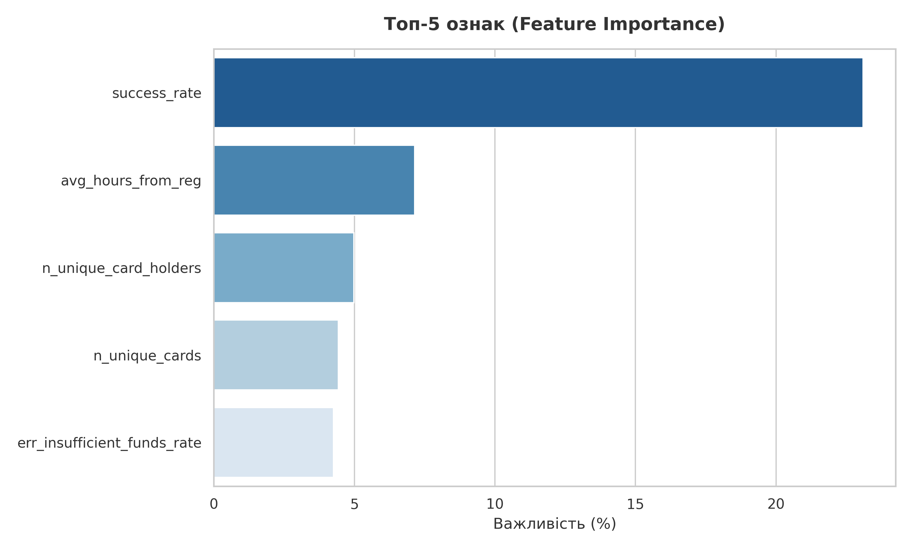
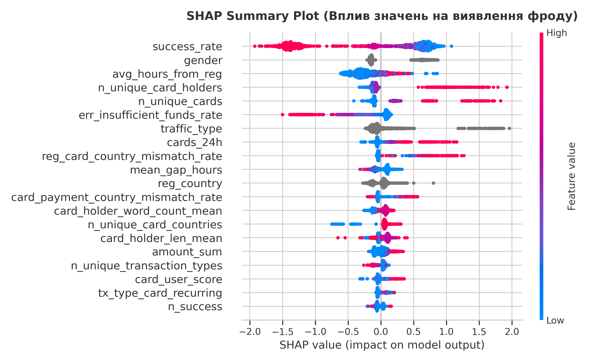
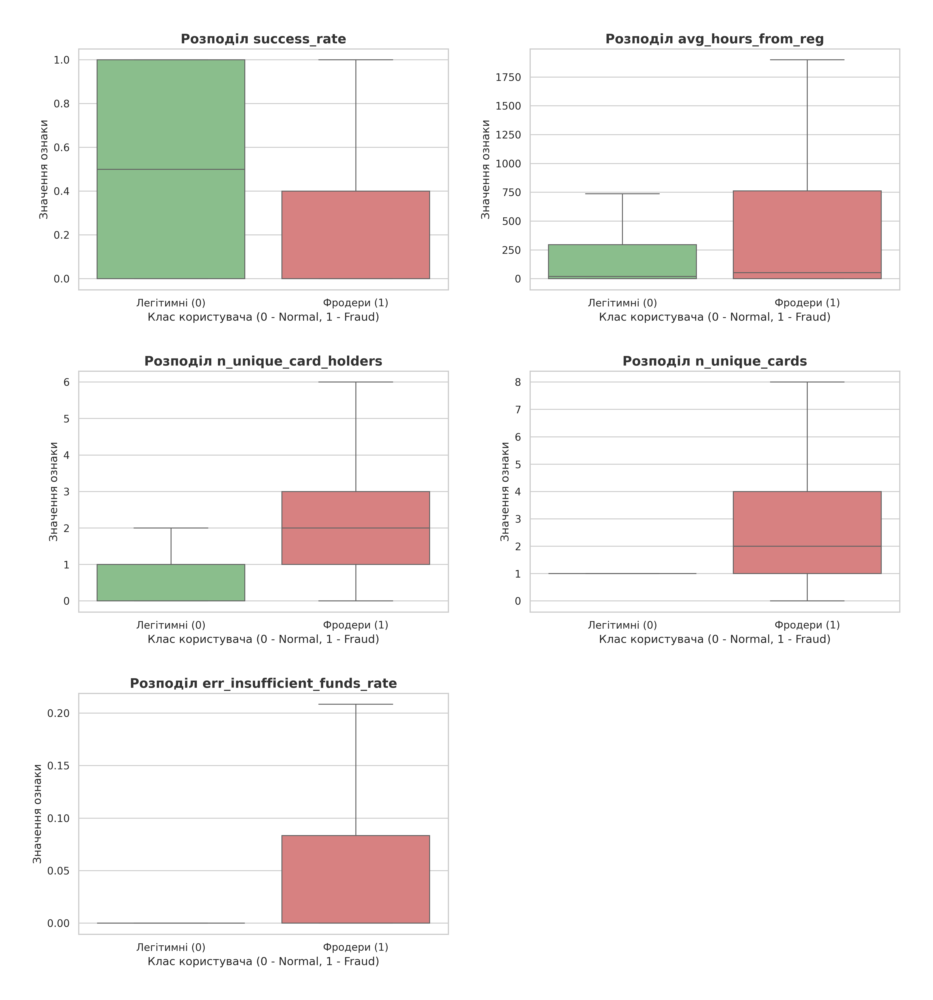
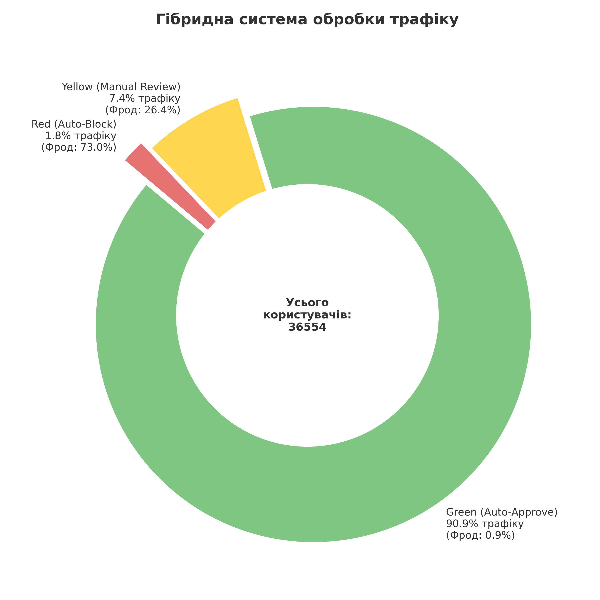

# Anti-fraud test task

## 1. Technical Implementation and F1-score Maximization

To solve the problem, an ML system based on the gradient boosting algorithm **CatBoostClassifier** was developed. This choice is driven by its high efficiency when working with categorical features and its robustness against overfitting.

### Key Technical Decisions:

- **Time-based data split:** To avoid lookahead bias and data leakage, the split into training and validation sets (80/20) was performed **by user registration time** (`timestamp_reg`).

- **Combating Data Leakage:** Error statuses **that are a direct consequence of a user being blocked by the system** (e.g., `fraud` or `antifraud` errors) were intentionally excluded from feature generation. This allowed the model to discover actual behavioral patterns.

- **Feature Engineering:** A set of aggregated metrics was engineered for each user:
	- **velocity features** (speed of actions after registration)
	- **card connection graph** (how many users share the same card)
	- **geographic discrepancy metrics**
	- **frequencies of specific bank errors**

### Model Results:

Training was conducted with the optimization of the **ROC-AUC metric (result: 0.9564)** to produce a high-quality probability distribution.
*The optimal threshold for maximizing the target F1 metric was `0.89`.*

- **F1-score:** 0.5605
- **Precision:** 0.5391
- **Recall:** 0.5837

## 2. Top-5 Key Features and Their Impact

Based on the analysis of **Feature Importance** and **SHAP values**, 5 key fraud predictors were identified.

### Hypotheses Validation

1) **success_rate** (Percentage of successful transactions)
	**Explanation:** \
	The most important feature. Fraudsters work with purchased databases of stolen cards. Most of these cards are already blocked or have no funds, which is why the percentage of successful payments among fraudsters is abnormally low (median is 0% success vs. 50% for legitimate clients). \
    **Impact (SHAP):** \
	A low success_rate (blue dots on the SHAP plot) drastically increases the probability of fraud.

2) **avg_hours_from_reg** (Average time from registration to transaction)
	**Explanation:** \
	Raw data analysis revealed the following: contrary to expectations of "fast bots", fraudsters on average initiate transactions significantly later than legitimate users (median of 53 hours vs. 20 hours). \
    **Impact (SHAP):** \
	A longer time from registration (red/purple dots on the plot) increases the probability of classifying the user as a fraudster.

3) **n_unique_card_holders** (Number of unique cardholder names) \
    **Explanation:** \
	A legitimate user almost always uses their own cards where the name matches (median = 1). Conversely, having 2 or more different cardholder names on a single account is atypical behavior that reveals the use of third-party payment details.
    **Impact (SHAP):** \
	High values (red dots) strongly push the model prediction toward the "fraud" class.

4) **n_unique_cards** (Number of unique cards) \
	**Explanation:** \
	Similar to the previous point. Statistically, an average legitimate client uses exactly 1 card (with no variance). An attempt to link many different cards (this figure reaches 8 or more for fraudsters).
    **Impact (SHAP):** \
	A high feature value increases the risk of fraud.

5) **err_insufficient_funds_rate** (Share of "insufficient funds" errors) \
    **Explanation:** \
	Although the overall average rate of such errors is roughly similar across both groups (~9%), distribution analysis indicates that fraudsters encounter this error systematically while brute-forcing empty cards. This feature acts not as a standalone marker, but as a trigger in combination with a large number of cards. \
    **Impact (SHAP):** \
	A high frequency of such errors (red dots on SHAP) serves as a consistent indicator of fraudulent behavior for the model.

## 3. Integration into Business Processes

Since the model's Precision is ~54%, applying a hard "approve/block" rule **would lead to the automatic ban of a significant number of legitimate clients (False Positives)**. \
This translates to lost revenue and reputational risks for the business.

**To solve this problem, a Hybrid Approach was developed**, based on probabilities (predict_proba) produced by the model. \
Traffic is split into three zones using custom thresholds (0.75 and 0.96):

- 🟢 **Green Zone (Auto-Approve):** *Score < 0.75*
	- **Traffic:** 90.86% of users.
	- **Business Action:** Auto-approve.
	- **Rationale:** The business creates no friction for 91% of clients. The fraud rate here is only 0.95% — an economically viable level that is fully offset by revenue from successful transactions.

- 🟡 **Yellow Zone (Manual Review):** *0.75 <= Score < 0.96*
	- **Traffic:** 7.37% of users.
	- **Business Action:** Suspend transaction. Route the user for Manual Review by the anti-fraud team or request additional automated verification.
	- **Rationale:** Fraud rate is 26.4%. Support team workload accounts for less than 7.5% of total traffic.

- 🔴 **Red Zone (Auto-Block):** *Score >= 0.96*
	- **Traffic:** 1.77% of users.
	- **Business Action:** Hard automated profile block.
	- **Rationale:** This zone contains fraudsters most apparent to the model (fraud rate ~73%).

The proposed hybrid model automates over 92% of decisions (Green + Red), optimizes operational costs for manual review, and preserves the loyalty of legitimate platform clients.

## 4. Future Development and Scaling Directions
### Technical Model Improvements

- **Hyperparameter Tuning:** The current CatBoost model uses default settings. Using frameworks like Optuna for comprehensive hyperparameter optimization will yield additional percentage points in accuracy.

- **Ensembling:** To improve system robustness, CatBoost predictions can be combined with other architectures (e.g., LightGBM or neural networks that effectively extract embeddings from text fields such as cardholder names).

### Advanced Feature Engineering
To separate professional fraudsters from legitimate clients more accurately, it is necessary to go beyond basic transactional aggregations. Moving forward, the focus should be on expanding and detailing each user's "profile", as well as performing advanced work with text attributes.

Further work is also needed on building a more complete feature relationship graph.

### Business Process Optimization
From an operational perspective, the system should not only detect fraudsters but also save company resources.
- **Precision vs. Recall Balance (Workload Management):** Currently, around 7% of traffic falls into manual review. The main future business objective is to reduce this figure. To achieve this, key metrics must be managed intentionally.
- **"Gray Zone" Automation (Review Simplification):** Instead of immediately routing all suspicious users from the "Yellow Zone" to human review, this workflow should be streamlined.
- **Dynamic Thresholds:** Instead of hardcoded thresholds (e.g., 0.75 and 0.96), a system that automatically shifts these boundaries based on current business conditions can be implemented.